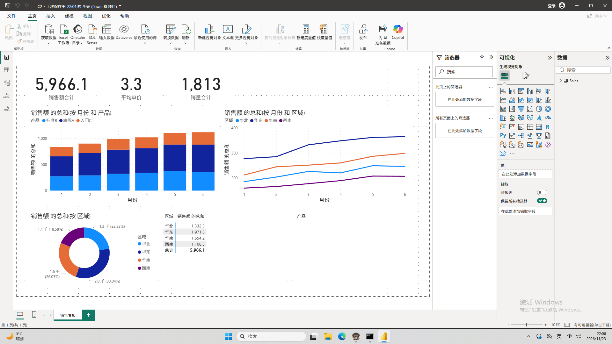

# pbipgen

**Generate a working Power BI report from a JSON spec — no dragging, no clicking, no Windows.**

[PBIP](https://learn.microsoft.com/power-bi/developer/projects/projects-overview) (Power BI Project)
is a folder of plain text: TMDL for the semantic model, PBIR JSON for the report layout.
That means a report can be *written* instead of *built by hand*. `pbipgen` does exactly that —
one file, Python standard library only, no `pbi-cli`, no Analysis Services connection, no Windows.

Open the output in Power BI Desktop, hit **Refresh** once, and every visual has data.



*(The screenshot above is a real Desktop render of `examples/sales/spec.json` — 8 visuals,
zero manual steps beyond the refresh click.)*

---

## Why

The Power BI authoring loop is manual: drag a field, drop it on an axis, discover the legend
silently ignored your column because the role is called `Series` and not `Legend`. None of it
is reproducible, none of it is reviewable, all of it is a diff you cannot read.

PBIP output is a file tree. So treat report authoring like code:

- a spec is 60 lines you can review in a PR
- regenerating is deterministic (modulo lineage GUIDs)
- the same spec renders the same report on anyone's machine
- no Desktop license needed to *produce*; only to *render*

## Quick start

```bash
python3 pbipgen.py examples/sales/spec.json
# OK /path/to/build/sales
```

Then open `build/sales/SalesDemo.pbip` in Power BI Desktop and click **Refresh**.
The CSV path is resolved relative to the spec file and baked in as an absolute path,
so the data travels with the project.

Requirements: Python 3.10+ (the code uses `str | None` and `tuple[str, str]`),
and Power BI Desktop to *view* the result.

## Spec format

```json
{
  "name": "SalesDemo",
  "out": "build/sales",
  "table": "Sales",
  "csv": "data/sales.csv",
  "culture": "en-US",
  "columns": [
    {"name": "Month",  "type": "int64",  "format": "0",       "summarize": "none"},
    {"name": "Amount", "type": "double", "format": "#,##0.0", "summarize": "sum"}
  ],
  "measures": [
    {"name": "Total Amount", "dax": "SUM(Sales[Amount])", "format": "#,##0.0"},
    {"name": "MoM",
     "dax": "VAR m = MAX(Sales[Month])\n\t\t\tVAR cur = CALCULATE(SUM(Sales[Amount]), Sales[Month] = m)\n\t\t\tVAR prev = CALCULATE(SUM(Sales[Amount]), Sales[Month] = m - 1)\n\t\t\tRETURN DIVIDE(cur - prev, prev)",
     "format": "0.0%"}
  ],
  "page": {"name": "p1", "display": "Sales", "width": 1280, "height": 720},
  "visuals": [
    {"name": "c1", "type": "card", "x": 40, "y": 12, "w": 200, "h": 105,
     "values": "Sales[Total Amount]"},
    {"name": "v1", "type": "column_chart", "x": 40, "y": 136, "w": 580, "h": 300,
     "category": "Sales[Month]", "y_field": "Sales[Amount]", "series": "Sales[Region]"}
  ]
}
```

| key | meaning |
|---|---|
| `name` | project name → `X.pbip`, `X.Report/`, `X.SemanticModel/` |
| `out` | output directory (defaults to `name`) |
| `table` | table name; columns/measures are declared on it |
| `csv` | data source; relative paths resolve against the spec's directory |
| `culture` | model culture, default `en-US` |
| `columns[].type` | `string` / `int64` / `double` / `decimal` / `dateTime` / `boolean` |
| `columns[].summarize` | `sum` / `none` / `average` / `min` / `max` / `count` |
| `measures[].dax` | DAX body, no leading `=`. Multi-line: `\n` + 3 tabs on continuation lines |
| `visuals[].type` | any alias from the table below |

### Role keys → PBIR roles

| spec key | PBIR role |
|---|---|
| `category` | `Category` |
| `y_field`, `value`, `measure` | `Y` |
| `series`, `legend` | `Series` |
| `values`, `field` | `Values` |
| `rows` / `columns` | `Rows` / `Columns` |
| `x_field` | `X` |
| `indicator` / `trend` / `goal` | `Indicator` / `TrendLine` / `Goal` |
| `target` / `min` / `max` | `TargetValue` / `MinValue` / `MaxValue` |

> **`y` is taken.** `y` is the layout coordinate, so the value role is spelled `y_field`.
> (First version bound the number `12` as a role and reported *"visual 'c1' (card) has no 'Y' role"*.)

### Supported visuals

`bar_chart` `column_chart` `clustered_bar` `clustered_column` `stacked_bar` `stacked_column`
`line_chart` `area` `ribbon` `card` `card_new` `table` `matrix` `donut` `pie` `funnel`
`treemap` `waterfall` `kpi` `gauge` `scatter` `slicer`

Each maps to a fixed role set in `ROLES`. A field bound to a role outside that set aborts the build.

---

## What the generator refuses to do

Power BI's failure mode is **silence**: a wrong role name, a dropped field, an untyped column —
none of them raise an error, the visual just comes out empty or wrong. So the generator validates
before writing, and exits non-zero instead of emitting a plausible-but-broken file:

1. **Unknown role** — binding `{"legend": ...}` on a `barChart` is fine (`legend` → `Series`), but binding
   something the visual type does not own aborts. Desktop would have dropped it silently.
2. **Unknown field** — any `Table[Field]` not present in the TMDL column/measure index aborts.
   No empty projections, no "one or more fields have an error" mystery.
3. **Empty page** — `pages.json` always carries `pageOrder` + `activePageName`. A PBIP with
   `{"pageOrder": []}` makes Desktop refuse to load the file with *"The report has no pages"*,
   and the only way out is closing Desktop.

## Gotchas baked into the code

Each of these cost a debugging session against a real Desktop instance:

| Symptom | Cause | Handling |
|---|---|---|
| Legend never appears, all categories summed into one series | bar/line legend role is `Series`, not `Legend`; wrong name is silently ignored | role set per visual type, hard-checked |
| `The function SUM cannot use values of type String` | M partition used `#table(...)`/nothing, Power Query inferred text; TMDL `dataType` does not override it | partition always goes `Csv.Document` → `PromoteHeaders` → `TransformColumnTypes` with explicit types |
| DAX measure parses as missing/garbled | multi-line `measure X = VAR ...` on one line — TMDL is indentation-sensitive | `measure X =` ends the line, DAX body indented 3 tabs |
| Report will not open: *"the report has no pages"* | `pbi report create` emits an empty `pageOrder` | page + `activePageName` always written |
| `DATEADD` fails on a plain year column | not a date column | use `MAX()` + `CALCULATE(..., key = m - 1)` |
| Axis reads `Sum of Year` | value-column implicit aggregation applied to a category axis | only `Y / Values / X / TargetValue / ...` may aggregate; axes get `"active": true` and no aggregation |
| Edits disappear after reopening | Desktop writes its in-memory state back on exit | close Desktop before regenerating |
| `BitBlt: access denied` when automating | machine locked / session 0 has no interactive desktop | not a permission problem; run UI work in the interactive session |

## Verified

Two end-to-end runs against Power BI Desktop (Windows, Desktop 2024+):

**Finance** (`examples/finance`) — 5 visuals. Cards `192.92` / `4.9%` / `61.9%`.
Checked by hand: `25.62+32.18+39.75+44.31+51.06 = 192.92`;
net margin `9.53/192.92 = 4.94%`; debt ratio `1 − 183.58/481.26 = 61.85%`.

**Sales** (`examples/sales`) — 8 visuals over 72 rows, all four visual families at once:

- cards `5,966.1` / `3.3` / `1,813`
- stacked column, `Series=产品` — title becomes *"Sum of 销售额 by 月份 and 产品"*, three-color legend intact
- line, `Series=区域` — four lines, legend 华北 / 华东 / 华南 / 西南
- donut — 33.04 / 26.05 / 22.33 / 18.58 %
- matrix — per-region totals, grand total `5,966.1` matching the card
- table — multi-projection `Values` role

Cross-checked against `pbi-cli v3.12.0`: the same spec authored through `pbi visual add/bind`
produces **semantically identical** `visual.json` (only `tabOrder` differs) and a `Fin.tmdl`
that differs only in whitespace and `lineageTag` presence.

## Limits

- One table per spec. Multi-table models (relationships, date tables) are not covered yet.
- Import mode only (`Csv.Document`). No DirectQuery, no live connections.
- Import mode means **the CSV must exist on the machine rendering the report**.
- The visual still needs one **Refresh** click — Desktop does not load data on open. That click is
  not scriptable from the file format; it is a Desktop behavior, not a generator gap.
- Formatting beyond `formatString` (colors, titles, conditional formatting) is not emitted —
  Desktop fills defaults. Adding a `visualConfig` passthrough is the obvious next step.
- `z` / `tabOrder` follow spec order; overlap is not detected.

## License

MIT — see [LICENSE](LICENSE).
